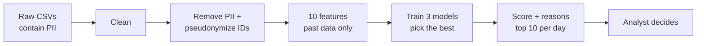

# Case 1: Fraud Risk Prediction

Ranks payment transactions by fraud risk so analysts review the most suspicious ones first.
The system **never decides a case is fraud**: every row starts as `PENDING_REVIEW` and an analyst decides.

All data is synthetic. All numbers below come from running the commands in this README.

## How to run

Tested with Python 3.14.5. Run from this folder.

```bash
python -m venv .venv
.venv\Scripts\activate              # macOS/Linux: source .venv/bin/activate
pip install -r requirements.txt

# Secret for pseudonymizing IDs (16+ characters), see .env.example
$env:FRAUD_PSEUDONYM_KEY="local-demo-key-change-me"    # macOS/Linux: export FRAUD_PSEUDONYM_KEY=...

python -m fraud_risk.generate_data   # create synthetic data   -> data/raw/
python -m fraud_risk.train           # train and compare models -> models/, reports/metrics.md
python -m fraud_risk.predict         # score June               -> reports/review_queue.csv
pytest                               # 23 tests
```

Each step takes a few seconds on a laptop.

## How it works



Everything runs locally. **No data is sent to any external service.** PII exists only in the raw CSVs
(left of "Remove PII"); everything after it uses pseudonymized IDs.

| File | What it does |
|---|---|
| `fraud_risk/generate_data.py` | Creates 3 tables (customers, transactions, login_events) with fraud and messy data |
| `fraud_risk/clean.py` | Fixes data problems and writes `reports/data_quality.md` |
| `fraud_risk/privacy.py` | Removes PII, pseudonymizes IDs, masks PII in logs |
| `fraud_risk/features.py` | Builds the 10 features and the reason-code rules |
| `fraud_risk/train.py` | Splits by time, trains 3 models, picks one, writes metrics |
| `fraud_risk/predict.py` | Writes the daily review queue |

## Key decisions

- **Label = `is_confirmed_fraud`** (analyst-reviewed). `is_blocked` is **not** used: 28 blocked customers
  had no fraud, 30 fraud victims were never blocked, and blocking happens *after* fraud, which would leak the future.
- **Features use only the past.** Each one looks at events strictly before the transaction.
- **Split by time:** January = warm-up, Feb–Apr = train, May = pick the model, June = final test.
- **Analysts can review 10 transactions per day** (assumption), so we flag the top 10 per day.
- **Model choice:** best May PR-AUC wins, unless a simpler model is within 0.02.

## Data problems handled

| Problem | Rows | Fix |
|---|---:|---|
| Customer ID in different formats (`c-12`, `CUST_12`) | 4,418 | Normalized to `C00012` |
| Duplicate transactions | 862 | Keep one |
| Missing timestamp | 460 | Dropped |
| Missing device | 791 | Set to `UNKNOWN` |

Full list: [`reports/data_quality.md`](reports/data_quality.md).

## Features

| Feature | Meaning |
|---|---|
| `amount` | Transaction amount |
| `amount_to_avg_30d` | Amount compared to the customer's 30-day average |
| `txn_count_1h` / `txn_count_24h` | Customer's transactions in the previous hour / day |
| `minutes_since_last_txn` | Time since the previous transaction |
| `is_new_device` | Device never used before by this customer |
| `failed_logins_24h` | Failed logins in the previous 24 hours |
| `is_night` | Between 00:00 and 04:59 |
| `account_age_days` | Days since signup |
| `is_high_risk_merchant` | Gift card, crypto or game voucher |

## Results (June test set)

| Model | PR-AUC | Fraud caught (recall) | Precision | Accuracy |
|---|---:|---:|---:|---:|
| Always say "not fraud" | 0.01 | 0% (0/84) | 0% | **98.8%** |
| Rules (baseline) | 0.88 | 95% (80/84) | 27% | 96.8% |
| Logistic regression | 0.96 | 96% (81/84) | 27% | 96.8% |
| **Gradient boosting** ✅ | **0.98** | 95% (80/84) | 27% | 96.8% |

Recall, precision and accuracy are measured at 10 reviews per day.
Gradient boosting was chosen because it won May by 0.036 PR-AUC (more than the 0.02 margin).
Full tables, including May and the confusion matrix: [`reports/metrics.md`](reports/metrics.md).

What this shows:
1. **Accuracy is misleading.** Saying "not fraud" every time scores the highest accuracy but catches nothing.
2. **Precision 27% is near the maximum.** June has 84 frauds but 300 review slots (10 × 30 days),
   so even a perfect model reaches only 28%.
3. **The ranking works.** 43% of rank 1–3 rows are fraud, vs 3% at rank 10.

## Sample output

From [`reports/review_queue.csv`](reports/review_queue.csv):

| rank | transaction | customer_ref | time | amount | score | reason_codes | status |
|---:|---|---|---|---:|---:|---|---|
| 1 | T0036178 | P_4c89a2b6… | 02:06 | 239,100 | 0.999 | FAILED_LOGINS_BEFORE_TXN, HIGH_VELOCITY, NIGHT_TIME, HIGH_RISK_MERCHANT | PENDING_REVIEW |
| 5 | T0036172 | P_4c89a2b6… | 01:31 | 475,700 | 0.998 | HIGH_AMOUNT_VS_HISTORY, NEW_DEVICE, FAILED_LOGINS_BEFORE_TXN, NIGHT_TIME | PENDING_REVIEW |

Every row also has `model_version` (`hgb-v1`).

**Analyst review:** read the reasons → check the case → set `review_status` to `CONFIRMED_FRAUD`,
`LEGITIMATE` or `ESCALATE`. These decisions become labels for the next training run.

## Privacy and security

| Control | How |
|---|---|
| Data map | In: 3 raw tables (PII = name, email, phone). Stored: raw CSVs, model file, reports (pseudonymized only). Logged: counts and paths. Sent out: nothing. |
| Minimization | Only the columns the model needs are kept; name, email, phone, city and `is_blocked` are dropped first |
| Pseudonymization | Customer and device IDs replaced with HMAC hashes (`P_…`, `D_…`) |
| Access control | Only the holder of the secret key can link `customer_ref` back to a person |
| Secrets | Key read from an environment variable, never stored in code |
| Logs | Emails and phone numbers are masked automatically |
| Bad input | Missing columns, key or model file: clear error, exit code 2, no output |
| Model file | Loaded with joblib (pickle): only load files this project created |

Encryption at rest, TLS and data-retention periods are recommendations for production, not implemented in this prototype.

**Security tests (all pass):**

| Test | Checks that... |
|---|---|
| `test_minimize_drops_pii_and_blocked_flag` | PII never reaches the model |
| `test_review_queue_file_contains_no_raw_identifiers` | The output file has no email, phone or real ID |
| `test_logs_mask_email_and_phone` | Logs never show raw email or phone |
| `test_input_missing_required_column_is_rejected` | A broken input file is refused |
| `test_missing_pseudonym_key_stops_the_run` | Nothing runs without the secret key |
| `test_pseudonym_depends_on_secret_key` | Pseudonyms cannot be guessed without the key |

## Tests

`pytest` runs 23 tests. The most important ones:

- `test_features_ignore_events_after_the_transaction`: **leakage test**. Removing all future data must not change any feature.
- `test_time_split_is_ordered_and_does_not_overlap`: train, validation and test never mix in time.
- `test_history_features_on_a_hand_checked_example`: feature values match a hand calculation.
- `test_always_legit_scores_high_accuracy_but_catches_no_fraud`: proves accuracy alone is misleading.

## Operations and cost

- **Batch, once per day**, because analysts work a daily queue. Real-time blocking is out of scope.
- **Monitoring:** confirmed-fraud rate in the queue, data-quality counts, feature drift.
- **Rollback:** every row records `model_version`; keep old model files and point `--model` back.
- **Cost (estimate):** a small VM ≈ US$10–20/month, storage < US$1, no paid AI APIs.
  The main cost is analyst time (10 reviews/day).

## Limitations

- **Synthetic data is easier than real data.** Expect lower scores in practice; real performance needs real reviewed cases.
- Labels come from past reviews, so fraud that was never caught looks legitimate.
- `is_new_device` only flags the first payment from a new device in an attack.
- Reason codes are simple rules, not an exact explanation of the model.
- 460 rows with missing timestamps are dropped and never scored.

## Next steps

1. Test on real or public labelled data.
2. Compare 3, 5 and 10 reviews per day to help size the analyst team.
3. Retrain on train + validation, and add drift monitoring.
