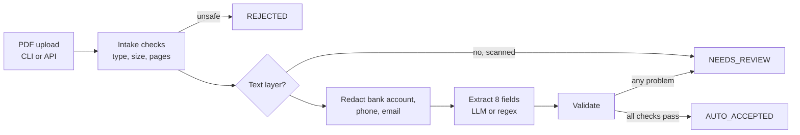

# Case 2: Document Intelligence (Invoices)

Reads invoice PDFs and returns 8 fields as validated JSON. Anything incomplete, inconsistent or
uncertain is sent to **manual review** with the exact reasons. Nothing leaves the machine: the LLM runs locally.

All invoices are synthetic. All numbers below come from running the commands in this README.

## How to run

Tested with Python 3.14.5 on Windows 11. Run from this folder.

```bash
python -m venv .venv
.venv\Scripts\activate              # macOS/Linux: source .venv/bin/activate
pip install -r requirements.txt

python -m invoice_extractor.generate_invoices                       # 30 invoices + expected.json + bad files
python -m invoice_extractor.extract data/invoices/invoice_002.pdf   # extract with the local LLM (default)
python -m invoice_extractor.extract --method regex data/invoices/invoice_002.pdf   # no GPU needed
python -m invoice_extractor.extract --show-prompt data/invoices/invoice_002.pdf    # exactly what the LLM would receive
python -m invoice_extractor.evaluate                                # regex vs LLM -> reports/evaluation.md
pytest                                                              # 44 tests, no Ollama needed

# Upload API: open http://127.0.0.1:8000/docs, POST /extract, "Try it out", fill x-api-key and choose a PDF
$env:INVOICE_API_KEY="local-demo-key"                              # macOS/Linux: export INVOICE_API_KEY=...
uvicorn invoice_extractor.api:app
```

The LLM needs [Ollama](https://ollama.com) running with `ollama pull qwen3:4b-instruct` (2.5 GB).
Without it, use `--method regex` (CLI) or `?method=regex` (API).

## How it works



- **Trust boundary:** the LLM is Ollama on `localhost`. The code refuses any other endpoint unless
  `ALLOW_EXTERNAL_LLM=true` is set after the transfer has been approved.
- Files are processed in memory; nothing is saved to disk.

| File | What it does |
|---|---|
| `invoice_extractor/generate_invoices.py` | 30 synthetic invoices in 3 layouts, expected values, unsafe files |
| `invoice_extractor/intake.py` | Rejects unsafe or unsupported files before parsing |
| `invoice_extractor/extract.py` | Regex extractor, pipeline, CLI |
| `invoice_extractor/llm.py` | Local LLM extractor (Ollama, JSON schema, temperature 0) |
| `invoice_extractor/validate.py` | Normalizes values, checks rules, decides review |
| `invoice_extractor/privacy.py` | Redaction and content-free logs |
| `invoice_extractor/evaluate.py` | Compares both extractors on the labelled set |
| `invoice_extractor/api.py` | Upload API with API-key check |

## Fields and validation

| Field | Example | Check |
|---|---|---|
| `invoice_number` | INV-2026-1002 | present |
| `invoice_date` | 2026-08-23 | valid date (accepts `2026-08-23`, `23/08/2026`, `23 Agu 2026`) |
| `due_date` | 2026-10-07 | valid date, not before invoice date |
| `vendor_name` | PT Logistik Prima | present |
| `vendor_tax_id` | 07.846.579.1-970.000 | NPWP format |
| `subtotal` | 2400000 | integer rupiah |
| `tax_amount` | 264000 | 11% of subtotal |
| `total_amount` | 2664000 | subtotal + tax |

Every value must also **appear in the document text**. A value the model invented or mis-copied is flagged
`NOT_FOUND_IN_DOCUMENT_<FIELD>`.

There is **no confidence percentage**: a model's self-reported confidence is not a calibrated probability.
Instead each result has a status and the reasons:

```json
{"status": "NEEDS_REVIEW", "review_reasons": ["TOTAL_MISMATCH"], "fields": {...}}
```

**Manual review path:** every `NEEDS_REVIEW` result goes to a finance clerk, who opens the original PDF,
checks the listed reasons and corrects the fields. `AUTO_ACCEPTED` results can be posted directly.

## Why regex vs a local LLM

| | Regex | Local LLM (qwen3 4B) |
|---|---|---|
| Speed | instant | ~4 s per invoice |
| Cost | free | electricity only |
| New invoice layouts | breaks | adapts |
| Risk | misses fields | can mis-copy or invent, so validation is essential |
| Privacy | local | local (no data leaves) |

OCR was not used: the invoices have a text layer. Scanned PDFs are sent to manual review instead of guessed.

## Results

30 invoices: layouts A and B (English, 20) were used to write the regex; layout C (Indonesian labels, 10)
plays a **new vendor format** that regex has never seen. Full report: [`reports/evaluation.md`](reports/evaluation.md).

| Metric | Regex | LLM ✅ |
|---|---:|---:|
| Field accuracy | 67.9% | **95.0%** |
| Missing-field rate | 33.2% | **3.0%** |
| Invoices fully correct | 20 / 30 | **24 / 30** |
| Auto-accepted | 13 | **16** |
| **Auto-accepted but wrong** | **0** | **0** |
| Latency (median / p95) | 0.002 s / 0.003 s | 3.9 s / 4.2 s |
| Tokens per invoice (in / out) | – | 389 / 142 |

| Layout | Regex | LLM |
|---|---:|---:|
| A (known) | 100% | 90% |
| B (known) | 100% | 99% |
| **C (new format)** | **4%** | **96%** |

What this shows:
1. **Regex is perfect on known layouts and collapses on a new one.** The LLM is stable across all three.
2. **No wrong result was auto-accepted** by either method: every error was caught and sent to review.
3. **The LLM makes subtle copy errors**, e.g. tax ID `16.756.253.6-400.000` copied as `16.756.250.6-400.000`.
   The "must appear in the document" check caught every one.
4. **The LLM can fail outright:** on `invoice_003` it hit a repetition loop. That document went to review as
   `EXTRACTOR_FAILED` instead of crashing the batch.

The **LLM is the default** because it is far more accurate, auto-accepts more invoices (less manual work),
and is just as safe.

## Sample input and output

Input [`data/invoices/invoice_002.pdf`](data/invoices/invoice_002.pdf) (layout C, as read from the PDF):

```
FAKTUR
Penjual: PT Logistik Prima
NPWP Penjual: 07.846.579.1-970.000
No. Faktur: INV-2026-1002
Tgl: 23 Agu 2026
Jatuh Tempo: 7 Okt 2026
...
Total Tagihan: Rp2.664.000
Rekening: 5070378921 - Telp: +6281287457446 - Email: finance2@vendor.example
```

Expected ([`data/expected.json`](data/expected.json)) and actual LLM output
([`reports/outputs/llm/invoice_002.json`](reports/outputs/llm/invoice_002.json)) match on all 8 fields:

```json
{
  "status": "AUTO_ACCEPTED",
  "fields": {
    "invoice_number": "INV-2026-1002", "invoice_date": "2026-08-23", "due_date": "2026-10-07",
    "vendor_name": "PT Logistik Prima", "vendor_tax_id": "07.846.579.1-970.000",
    "subtotal": 2400000, "tax_amount": 264000, "total_amount": 2664000
  }
}
```

All 60 actual outputs (regex and LLM): [`reports/outputs/`](reports/outputs/).

## Unsafe files

| File | Result |
|---|---|
| `corrupt.pdf` | REJECTED (CORRUPT_PDF) |
| `empty.pdf` | REJECTED (EMPTY_FILE) |
| `fake_executable.pdf` (an .exe renamed) | REJECTED (NOT_A_PDF) |
| `invoice.txt` | REJECTED (UNSUPPORTED_TYPE) |
| `scanned_no_text.pdf` | NEEDS_REVIEW (NO_TEXT_LAYER) |
| Over 5 MB | REJECTED (FILE_TOO_LARGE) |
| Over 5 pages / password-protected | REJECTED by code (not in the test set) |

The API returns 413, 415 or 422 for these, never a 500.

## Privacy and security

| Control | How |
|---|---|
| Data map | In: invoice PDFs (confidential: bank account, phone, email, tax ID). Sent to the LLM: redacted text only, to `localhost`. Stored: nothing from uploads; the evaluation writes outputs for the synthetic set only. Logged: content hash, status, reasons. |
| Minimization | Bank accounts, phones and emails are replaced with `[ACCOUNT_NUMBER]`, `[PHONE]`, `[EMAIL]` before the LLM sees the text |
| LLM privacy | `--show-prompt` prints exactly what would be sent. The local model is the privacy-preserving option; external endpoints are blocked unless approved |
| Access control | The API requires an `X-API-Key` header; with no key configured it refuses every request |
| Input validation | Content must start with `%PDF-`; size, page and encryption limits; the file name is never used as a path |
| Secrets | API key from an environment variable (`.env.example`), never in code |
| Logs | Content hash only; no file names, field values or contact data |

Encryption at rest, TLS and retention rules are recommendations for production, not implemented here.

**Security tests (all pass):**

| Test | Checks that... |
|---|---|
| `test_unsafe_files_are_rejected_before_parsing` | Corrupt, empty, disguised .exe and .txt files are refused |
| `test_oversized_file_is_rejected` | Files over 5 MB are refused |
| `test_redaction_removes_contact_and_bank_data_but_keeps_invoice_fields` | Redaction removes secrets without breaking extraction |
| `test_prompt_sent_to_llm_is_redacted` | The LLM never receives bank account, phone or email |
| `test_external_llm_endpoint_is_refused_without_approval` | Invoice text is not sent to an unapproved external LLM |
| `test_cli_logs_contain_no_document_content_and_bad_files_do_not_crash` | Logs never contain vendor names, invoice numbers or emails |
| `test_request_without_valid_api_key_is_refused` | No key or a wrong key gets 401 |
| `test_unsafe_uploads_get_a_4xx_not_a_crash` | Disguised, oversized and path-traversal uploads get 4xx |
| `test_oversized_request_is_refused_before_the_body_is_parsed` | Key and size are checked before the upload is read, so anonymous huge uploads cannot exhaust the server |

## Tests

`pytest` runs 44 tests without Ollama (the LLM is replaced by a fake). Besides the security tests above:
date and amount normalization, missing fields → review, invented values → review, arithmetic checks,
unparseable or failed LLM output → review, API happy path, LLM down → 503.

## Operations and cost

- **Real-time per document** (CLI or API), because invoices arrive one at a time; the evaluation runs as a batch.
- **Errors:** unsafe file → 4xx/REJECTED; model fails on one document → that document goes to review;
  model server down → clear error (CLI exit 2, API 503).
- **Monitoring:** review rate, review reasons, `EXTRACTOR_FAILED` count, latency.
- **Rollback:** switch model with `OLLAMA_MODEL`, or fall back to `method=regex`.
- **Cost (estimate):** ~4 s of laptop GPU per invoice ≈ IDR 0.16 of electricity (100 W, IDR 1,500/kWh).
  An external small-model API would be ≈ US$0.00014 per invoice at assumed example prices, but is not used.

## Limitations

- **Synthetic invoices are cleaner than real ones** (single page, clear labels, text layer). Expect lower accuracy on real documents.
- 30 invoices is a small evaluation set; one invoice changes accuracy by about 3 points.
- **LLM results vary slightly between runs** even at temperature 0 (95.4% in one run, 95.0% in the next).
- The model hit a repetition loop on one invoice and returned `0` as a total on another; both were caught, but the root cause was not investigated.
- No OCR: scanned invoices always need a human.
- Line items are not extracted.

## Next steps

1. Test on real (anonymized) invoices and add OCR for scans.
2. Ask the model for evidence spans and test a larger model for the copy errors.
3. A small review screen that shows the PDF next to the extracted fields.
