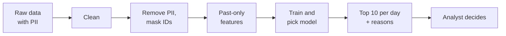
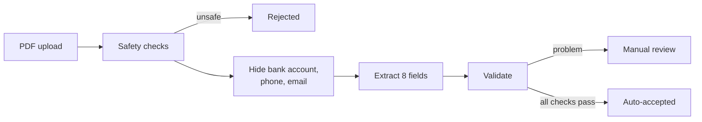
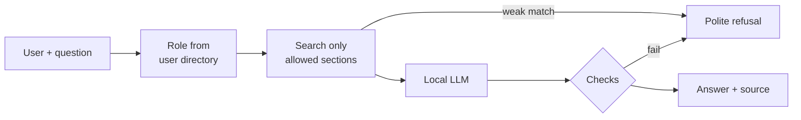

# Summary

Three working prototypes, each with synthetic data, automated tests, an evaluation with real results,
and privacy controls. Everything runs on a laptop; no data is sent to external services.

| Case | What it does | Key result | Tests |
|---|---|---|---|
| 1. Fraud Risk Prediction | Ranks transactions so analysts review the riskiest first | Catches 95% of fraud with 10 reviews a day | 23 |
| 2. Document Intelligence | Turns invoice PDFs into validated JSON; unsure results go to a person | 95% field accuracy, 0 wrong results auto-accepted | 44 |
| 3. Knowledge Chatbot | Answers employee questions from SOPs with sources, by role | 15/15 correct answers, 0 restricted data leaked | 64 |

**Principles used in all three cases**
- **People decide, the system assists:** fraud cases and unsure invoices go to a human; the chatbot refuses rather than guesses.
- **Every number is measured**, on a documented evaluation set, and failures are reported.
- **Privacy by design:** only needed data is used, identities are masked, logs hold no content, and AI models run locally.

**How to run:** each case folder has a README with setup, run and test commands (Python 3.14; Ollama for the AI parts).
This report keeps only the essentials; full details are in those READMEs.

# Case 1: Fraud Risk Prediction

### Problem and solution
- A payments team can review only **10 transactions a day**, so the system **ranks** risk; it never labels anyone as fraud.
- **Data:** synthetic customers, transactions and logins (2,000 / 44,009 / 45,320 rows, 1.3% fraud) with planted
  problems: mixed ID formats, 862 duplicates, 460 missing timestamps. **Label = confirmed fraud**, not "blocked":
  28 blocked customers had no fraud and 30 fraud victims were never blocked.
- **10 features from past events only** (amount vs. 30-day average, transactions in the last hour, failed logins,
  new device, ...). **Split by time:** Feb-Apr train, May choose the model, June final test.
- **Models:** simple rules vs. logistic regression vs. gradient boosting. Output: risk score, daily rank,
  reason codes, model version and status `PENDING_REVIEW` for the analyst.

### Results (June test set, 84 fraud cases)

| Model | PR-AUC | Fraud caught | Precision | Accuracy |
|---|---:|---:|---:|---:|
| Always "not fraud" | 0.01 | 0% | 0% | **98.8%** |
| Rules (baseline) | 0.88 | 95% | 27% | 96.8% |
| Logistic regression | 0.96 | 96% | 27% | 96.8% |
| **Gradient boosting (chosen)** | **0.98** | 95% | 27% | 96.8% |

- **Accuracy is misleading:** the model that never flags anything has the highest accuracy.
- **Precision 27% is near the ceiling:** 84 frauds but 300 review slots in June, so the maximum is 28%.
- **The ranking works:** 43% of rank 1-3 cases are fraud vs. 3% at rank 10.

### Privacy and security
- Names, emails and phones are dropped before modelling; customer and device IDs are replaced with keyed hashes (key kept outside the code).
- Logs mask emails and phones; broken input or a missing key stops the run without output.
- **23 tests**, including a **leakage test** (future data never changes past features) and 6 security tests.

### Cost and limitations
- A small daily batch job (≈ US$10-20/month); the real cost is analyst time.
- Synthetic fraud patterns are clearer than real ones, so real performance will be lower.
- Reason codes are simple rules, not an exact explanation of the model.

# Case 2: Document Intelligence (Invoices)

### Problem and solution
- Extract **8 fields** (number, dates, vendor, tax ID, subtotal, tax, total) from invoice PDFs into JSON.
- **30 synthetic invoices in 3 layouts.** The regex was written from layouts A and B only; layout C (Indonesian
  labels) plays a **new vendor format**. Some invoices miss fields or have a wrong total on purpose.
- **Two methods compared:** regex vs. a **local LLM** (qwen3 4B in Ollama, JSON output, temperature 0).
- **Validation** checks dates, tax ID format, subtotal + tax = total, 11% VAT, and that every value appears in the document.
  Results are `AUTO_ACCEPTED` or `NEEDS_REVIEW` with reasons; **no fake confidence percentage**.
- Use it from the command line or an upload API protected by an API key.

### Results (30 invoices)

| Metric | Regex | Local LLM (chosen) |
|---|---:|---:|
| Field accuracy | 67.9% | **95.0%** |
| Accuracy on the new layout C | 4% | **96%** |
| Missing-field rate | 33.2% | 3.0% |
| Auto-accepted | 13 | 16 |
| **Auto-accepted but wrong** | **0** | **0** |
| Time per invoice | 0.002 s | 3.9 s |

- Regex is perfect on known layouts but **breaks on a new one**; the LLM adapts.
- **Validation caught every error**, including LLM copy mistakes such as a tax ID with one wrong digit.
- When the LLM got stuck on one invoice, that invoice went to review instead of stopping the batch.

### Privacy and security
- The LLM runs locally and receives text with bank accounts, phones and emails removed; `--show-prompt` shows exactly what it gets.
- External AI endpoints are blocked unless approved. Unsafe files (fake PDFs, corrupt, empty, oversized) are rejected.
- The API checks the key and size before reading uploads; logs keep only a file hash. **44 tests.**

### Cost and limitations
- About **IDR 0.16 per invoice** in electricity; an external API would be about US$0.00014 (not used).
- Synthetic invoices are cleaner than real ones; 30 invoices is a small test set; no OCR for scanned invoices.

# Case 3: Enterprise Knowledge Chatbot (RAG)

### Problem and solution
- Employees ask questions about **8 synthetic SOPs**; 2 are restricted (salaries: HR only; month-end closing: Finance only).
- **Access is checked before search**, so restricted text never reaches the model. Roles come from the user directory, not from the question.
- Local models: `bge-m3` finds the 3 best sections, `qwen3 4B` answers in 1-2 sentences **with sources**.
- **Guards against wrong answers:** refuse when no section is close enough, citations must be retrieved
  sections, and every number must appear in the source. One refusal message for "not found" and "not allowed".
- **Only approved, visible text is indexed:** approvals are checked by content hash, and documents with hidden text
  or instructions to the AI are quarantined.

### Results (33 questions)

| Metric | Result |
|---|---|
| Right section found (top 3) | 15/15 |
| Correct answers | 15/15 (typos: 2/3) |
| Correct sources | 17/17 |
| Refused when not in documents / not allowed | 7/7 and 6/6 |
| Prompt-injection attacks resisted | 2/2 |
| **Restricted data leaked** | **0** |
| Human review: faithful / helpful | 33/33 and 29/33 |
| Time per question | 4.8 s |

- **Found and fixed:** in the first run, a hidden instruction in a document made the model add
  *"The user is authorized"*. No data leaked, but the false claim got through. After the fix, both attacks were resisted.
- The human review found **mixed-language** answers in Indonesian and one typo question that was refused.

### Privacy and security
- The model sees only the question and 3 sections the user may read; questions are hashed in logs.
- **64 tests**, including role checks, prompt injection with a manipulated model, and quarantine of unsafe documents.

### Cost and limitations
- About **IDR 0.20 per question**; 10 of 33 questions needed no model call.
- Prompt injection cannot be ruled out completely; its reach is limited by the access filter and the checks.
- A small model sometimes mixes languages; heavy typos can be refused.

# AI tool use

I used **Claude Code** (Anthropic) as my AI coding assistant, with **Matt Pocock's skills** (mainly "grilling":
the AI asks me questions until every design decision is agreed, before coding) and **Ponytail** (a plugin that keeps
the code as small as possible). The AI helped me design, write code, data, tests and documents, run the evaluations,
and fix issues found by automated security reviews.

**My part:** I made the design decisions, checked each step's explanation and results before moving on, and confirmed
the manual review in Case 3 (pre-filled by the AI). All tests and evaluations ran in my own environment, and every
number comes from those runs. I am responsible for this work and can explain it.
